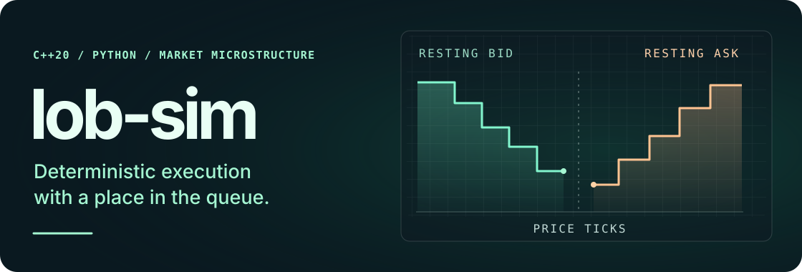

# lob-sim

**Replay the market. Test your place in the queue.** A deterministic C++20 limit order book with price-time FIFO, CSV and binary replay, and a queue-aware Python environment.

[Try the example](#quickstart) · [API and replay formats](docs/LOB_SIM.md) · [Candidate benchmarks and wheels](https://github.com/rishixgamer/lob-sim/actions/runs/44683503826) · [Project site](https://rishixgamer.github.io/lob-sim/)



## Quickstart

Ubuntu 24.04 · CPython 3.10 or 3.12 · C++20 compiler and CMake for a source build.

```sh
git clone https://github.com/rishixgamer/lob-sim.git
cd lob-sim
python3 -m venv .venv
. .venv/bin/activate
python -m pip install .
python -m lob_sim --replay fixtures/continuous/session.csv
```

The example quotes a buy, receives a partial fill, cancels the remainder, and then replays a normalized event fixture.

## What you can do

- **Match.** Submit limit and market orders to an integer-tick C++20 engine. Inspect price levels, individual orders, and FIFO position.
- **Replay.** Stream equivalent CSV and binary sessions through the same matcher. Inspect fills and statuses, with record-level diagnostics for malformed input.
- **Simulate.** Use seeded `BookEnv` episodes with queue information, inventory, and PnL. Read observations as zero-copy, contiguous NumPy arrays.

## Reproducible evidence

| Ubuntu 24.04 runner | 5 million events | 10 million events | Peak RSS |
| --- | ---: | ---: | ---: |
| ARM64 | 0.631 s | 1.264 s | 13.24 MB |
| x86_64 | 0.823 s | 1.657 s | 13.93 MB |

Single-threaded native matcher on a seeded synthetic stream. The [candidate run](https://github.com/rishixgamer/lob-sim/actions/runs/44683503826) includes the workload, sanitizer tests, wheel matrix, and checksums. The [merge-commit verification](https://github.com/rishixgamer/lob-sim/actions/runs/44792789146) passed on both architectures.

## FairCross research archive

`lob-sim` grew out of FairCross. The original uniform-price batch auction, proof experiments, and ITCH reconstruction have their own [overview and evidence](docs/FAIRCROSS.md). The C++ examples still use `faircross::continuous` and the existing CMake target names.

---

[v1.0 release candidate](docs/LOB_SIM.md#v10-release-notes) · [MIT License](LICENSE) · [Issues](https://github.com/rishixgamer/lob-sim/issues)

If lob-sim helps your research, [star the repository](https://github.com/rishixgamer/lob-sim).
